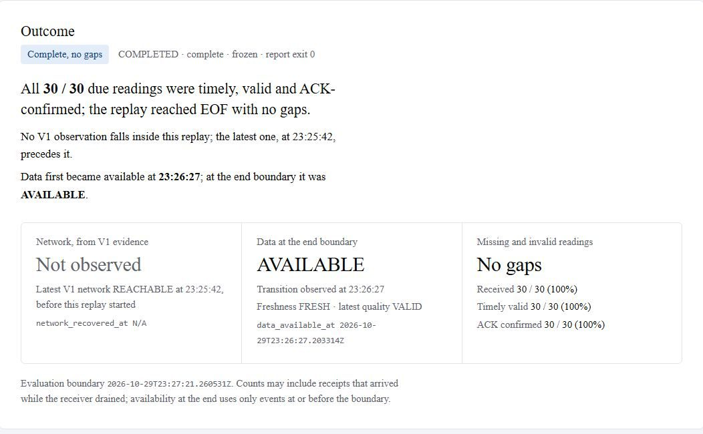
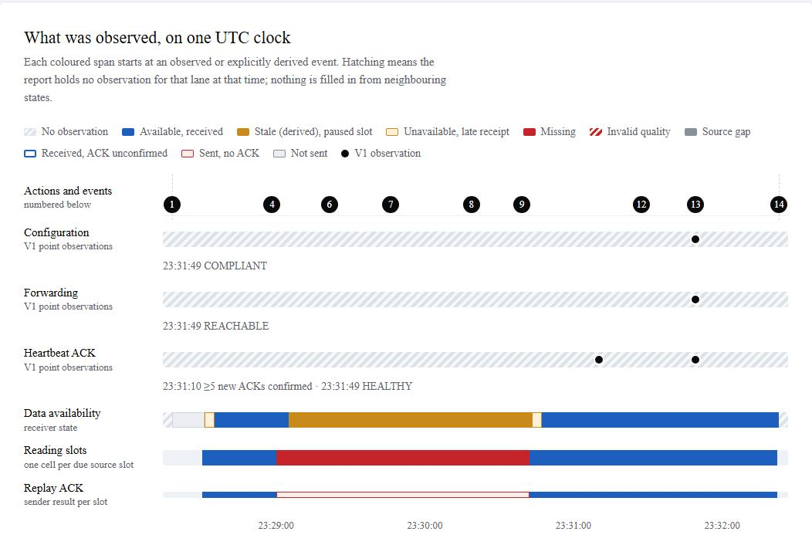
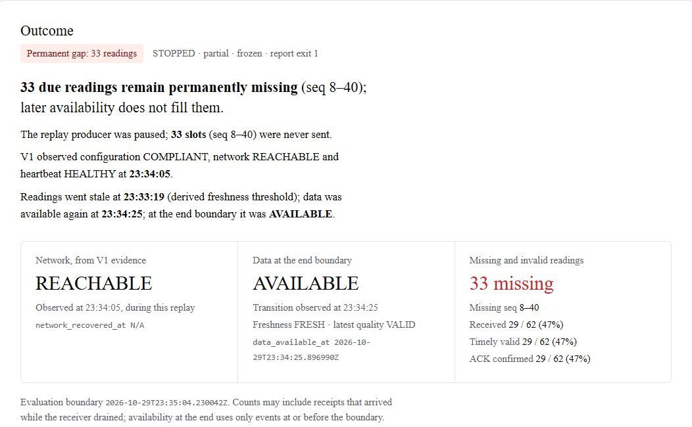
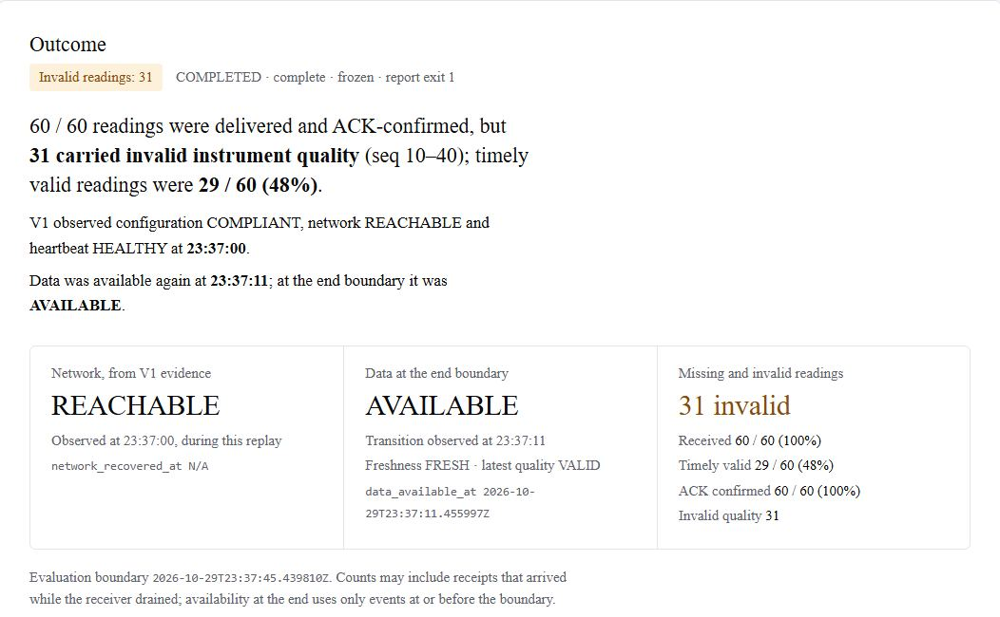

<p align="center">
  
</p>

# HopProof

Network Automation & Operations Lab

*Verify the route. Confirm the signal.*

I built HopProof to make network faults reproducible in a small local lab. A site sends messages through two virtual routers to a receiver. I use it to remove a managed route, inspect the resulting fault, and verify that new messages arrive after a repair.

The Linux/WSL application is free to use through [Releases](https://github.com/DDDYT24/HopProof/releases), under the terms included with the download. I'm keeping the application source private. This repository contains the project introduction and environment setup files.

## Why I built it

I wanted a lab where I could follow a fault from the router settings through to the application. A router can accept a configuration command while messages still fail to arrive. The route may be missing from the forwarding table, or the problem may be a broken link or a stopped receiver.

With just four nodes, I can follow the whole traffic path. The site sends a small heartbeat through both routers, and the receiver replies. That gives me an application-level check to compare with what the routers report.

```text
Site sender  -->  Router 1  -->  Router 2  -->  Central receiver
```

These are the networking terms used in the lab:

| Term | Plain-language meaning |
| --- | --- |
| Route | An instruction telling a router where to send traffic for a destination. |
| Static route | A route set explicitly by an operator or script. |
| Next hop | The neighboring router that should receive the traffic next. |
| Configuration drift | A difference between the intended settings and the current settings. |
| RIB and FIB | The RIB is the routing software's record of routes. The FIB is the operating system's table used to forward packets. HopProof checks both. |
| Heartbeat and ACK | A heartbeat is a small periodic message. An ACK is the receiver's reply, matched to that message's session and sequence number. |

I keep configuration, forwarding and application health separate in the diagnosis. If an observation is missing or too old, the result stays unknown. A repair only counts as successful when new messages receive matching replies after the change.

The other fault scenarios stop the sender or receiver, or bring down the link between the routers. I limited repair to one missing managed route. If the receiver has stopped, adding a route shouldn't count as fixing it. Each scenario can be restored from the CLI. All traffic is synthetic.

## Who it is for

The lab should suit students learning static routing, Linux networking and Ansible, or engineers who want somewhere to practise configuration checks. If you develop applications, you can also use it to see what a network fault looks like at the sending and receiving ends.

You'll need some familiarity with a terminal. I've kept the lab to a fixed IPv4 topology for local practice. I haven't validated it on production networks.

## What's new in 0.2.0

The first version answered one question for me: after I repair a route, do heartbeats get through again? Once that worked, I realised it wasn't the question I actually cared about. A monitoring site doesn't exist to send heartbeats. It exists to send readings. A link can come back while the data behind it is still stale, or arriving with a bad quality flag, or missing the minutes lost during the outage. In 0.2.0 I wanted the lab to tell those cases apart.

So I added a reading replay. Next to the heartbeat, the site now sends short runs of synthetic flow and pressure readings to the receiver. I took them from an earlier synthetic pipeline dataset and froze three small inputs for the lab. One is a clean 30-reading run, one is a longer 360-reading run for outage tests, and one is a 60-reading run where about half the readings carry an invalid quality flag. The replay sends each reading slot once. If the network is down when a slot comes due, that reading is gone. I deliberately left out retries and catch-up, because quietly filling a gap afterwards would hide exactly what I want to see.

The receiver only calls the data available again after three new, fresh and valid readings in a row. That gives the lab two separate recovery times. One is when the network came back, which I take from the V1 repair check. The other is when the data came back. I record both and don't assume one caused the other.

I also kept different kinds of trouble apart, because they need different responses:

- A broken route shows up as missed readings and stale data. Repair is still something I run myself; nothing in the replay changes a route.
- If I pause the producer, the data goes stale while the network and heartbeat stay healthy, and the lab leaves the routes alone.
- Readings that arrive on time with an invalid quality flag count as received but not usable. They don't make the network look broken.
- If the receiver stored a reading but its acknowledgement was lost, I don't count that reading as missing.
- When the source itself has no reading for a slot, I count that as a source gap, not as network loss.

Every replay ends with a report: JSON, Markdown and a single HTML page, all built from the same data. The page opens with the outcome in one sentence. Below that is a timeline with my actions, the V1 observations, data availability, each reading slot and the acknowledgements, followed by small charts of the readings. It loads nothing from the internet. The raw hashes and evidence sit in a folded section at the bottom. If the network recovered but readings were lost on the way, the page shows that gap clearly. I'd rather it never looked like a clean run.

I tested 0.2.0 the same way I tested the first release. In my WSL lab and on a temporary GitHub runner, I ran four real scenarios on the four-node network:

- a clean run to the end;
- a route removed and then repaired by hand;
- a paused and resumed replay, including a receiver restart;
- a run of invalid readings.

Around those, I added a slow acknowledgement, duplicate and late messages, a crashed sender and a shutdown during an active replay. The original V1 network matrix still passes. Before publishing, I ran the release archive itself through 56 checks on the runner, then extracted the same file again in WSL and ran all 56 there too.

0.2.0 is still a learning lab with synthetic data. It doesn't detect leaks, and I haven't run it against field equipment.

## How to use it

### What is available today

```text
README.md
assets/
  hopproof-logo.png
  replay/            report screenshots used in the example runs below
environment/
  baseline.yaml
  requirements-lock.txt
  setup-wsl.sh
```

I provide the environment files here and the application archive, along with its SHA-256 checksum, in [release v0.2.0](https://github.com/DDDYT24/HopProof/releases/tag/v0.2.0). Download both before starting. The archive includes the Linux x86_64 executable and its lab support files, usage terms and third-party notices. The application is free to use under those terms; it is not open source.

### Prepare the environment

I use a dedicated WSL2 Ubuntu 24.04 distribution on x86_64, with Docker Engine installed inside it. The setup helper expects the distribution to be named `NetOpsLab24`. On Windows, create it from PowerShell if that name is not already in use:

```powershell
wsl --install -d Ubuntu-24.04 --name NetOpsLab24 --no-launch --web-download
wsl -d NetOpsLab24 -u root
```

Download this repository as a ZIP from its GitHub page (the green download button, then **Download ZIP**) and extract it. In the WSL shell, change to the extracted directory. Replace `/mnt/c/path/to/HopProof` with its actual Linux path:

```bash
cd /mnt/c/path/to/HopProof
bash environment/setup-wsl.sh
```

Run the helper only in a new distribution dedicated to this lab. It installs Docker Engine, Containerlab and Python, creates the `netops` account with passwordless sudo, and writes that distribution's WSL settings. It does not reset or migrate other distributions. If you already have the project's prepared `NetOpsLab24` environment, skip this provisioning step.

Leave the root shell with `exit`, then open the lab account from PowerShell:

```powershell
wsl -d NetOpsLab24 -u netops
```

Return to the extracted repository directory in that shell and install the recorded Python dependencies:

```bash
/opt/netops-lab-venv/bin/python -m pip install -r environment/requirements-lock.txt
/opt/netops-lab-venv/bin/python -m pip check
python3.12 --version
docker version
containerlab version
/opt/netops-lab-venv/bin/ansible --version
```

A successful dependency check prints `No broken requirements found.` The lock file includes development tools as part of the recorded environment. It does not contain the HopProof application. `baseline.yaml` records tested versions, fixed base-image references, and the four subnets reserved for the lab. The helper installs Docker from its Ubuntu repository, so the installed Docker version may be newer than the recorded baseline.

Keep runtime state and SSH keys on the Linux filesystem, where their permissions can be enforced. Keep an interactive WSL shell open while running the lab; ending the distribution stops its containers. Check the reserved subnets for conflicts before deploying an application release.

### Download and run the application

In the `netops` WSL shell, put the release archive and its checksum in a new directory on the Linux filesystem. Verify and extract the archive:

```bash
sha256sum --check HopProof-0.2.0-linux-x86_64-*.tar.gz.sha256
tar -xzf HopProof-0.2.0-linux-x86_64-*.tar.gz
cd HopProof-0.2.0-linux-x86_64-*/
```

Pull the two images pinned in the supplied configuration:

```bash
/opt/netops-lab-venv/bin/python - <<'PY'
from pathlib import Path
import subprocess
import yaml
runtime = yaml.safe_load(Path("config/lab.yaml").read_text())["runtime"]
for name in ("router_image", "workload_base_image"):
    subprocess.run(["docker", "pull", runtime[name]], check=True)
PY
```

Run the commands from the extracted directory. `--runtime-root` keeps SSH keys on Linux storage, and `--instance` gives this experiment its own name:

```bash
./labctl --runtime-root "$HOME/netops-lab" --instance example validate
./labctl --runtime-root "$HOME/netops-lab" --instance example doctor
./labctl --runtime-root "$HOME/netops-lab" --instance example up
./labctl --runtime-root "$HOME/netops-lab" --instance example configure
./labctl --runtime-root "$HOME/netops-lab" --instance example diagnose
./labctl --runtime-root "$HOME/netops-lab" --instance example demo --scenario route-missing --action inject
./labctl --runtime-root "$HOME/netops-lab" --instance example repair
./labctl --runtime-root "$HOME/netops-lab" --instance example down
```

Each operation prints a report path under `artifacts`. Keep reports and runtime state private. If a change cannot be confirmed, inspect its report before retrying. Use the application's `down` command to clean up its own instance.

Here is what the main `labctl` commands do:

1. `validate` checks the intended configuration without contacting devices.
2. `doctor` checks the controller environment, permissions and subnet conflicts.
3. `render` prepares the instance files; `up` starts the lab without adding managed static routes.
4. `configure` adds the initial routes, confirms new matching ACKs, then saves and reads back the configuration.
5. `diagnose` writes separate configuration, network and application results. `monitor` repeats read-only checks; Ctrl+C leaves the lab running.
6. `down` removes that instance's containers and network while preserving reports.

Use `./labctl --help` for the command list and `USAGE.md` in the archive for exit codes and operating notes. The executable package was checked separately from source tests with real lab deployment, faults, repair and cleanup. Packaging does not prevent inspection or reverse engineering.

### Replay monitoring readings

Run a replay after `configure`, while the lab is healthy. The three sample inputs are in `examples/replay` inside the archive:

```bash
./labctl --runtime-root "$HOME/netops-lab" --instance example replay start --dataset examples/replay/normal-30.csv
./labctl --runtime-root "$HOME/netops-lab" --instance example replay status
./labctl --runtime-root "$HOME/netops-lab" --instance example replay stop
./labctl --runtime-root "$HOME/netops-lab" --instance example replay report --replay-id <id printed by start>
```

`pause` and `resume` hold and continue the same sender. The report command prints where it wrote report.json, summary.md and report.html.

### Example runs to try

These are the four replay runs I use to check the lab from end to end. Each one starts from a healthy lab after `configure`. The numbers and screenshots below come from one of my acceptance runs in WSL on 29 October 2026. Counts that depend on timing, such as how many slots fall inside a pause, will differ on your machine, but the shape of each result should match.

To keep the commands short, I define a small shell function in the extracted directory first:

```bash
lab() { ./labctl --runtime-root "$HOME/netops-lab" --instance example "$@"; }
```

| Run | Input | What I do | What the report should show |
| --- | --- | --- | --- |
| Clean run | `normal-30.csv` | Start it and let it finish | 30 of 30 readings received, acknowledged and valid; nothing missing; the report command exits 0 |
| Route removed and repaired | `normal-360.csv` | Remove r1's managed route during the run, diagnose, repair | A permanent gap (51 readings in my run), with network recovery and data recovery recorded separately |
| Pause and resume | `normal-360.csv` | Pause the sender, wait, resume | Paused slots counted as missing (33 in my run) while the network stays reachable |
| Invalid quality | `quality-invalid-60.csv` | Start it and let it finish | 60 of 60 received and acknowledged, but 31 flagged invalid and only 29 usable |

The last three report commands exit 1. In this lab, 1 means the report found something that still needs attention, which is exactly what these runs are meant to produce.

#### Clean run

```bash
lab replay validate --dataset examples/replay/normal-30.csv
lab replay start --dataset examples/replay/normal-30.csv
lab replay status      # repeat until producer shows COMPLETED
lab replay stop
lab replay report --replay-id <id printed by start>
```

`validate` checks the input before anything is sent; for the three samples it selects 30, 360 and 60 readings. The finished report says every due reading arrived on time, was acknowledged and carried a valid quality flag, and the data was available at the end.



#### Route removed and repaired

```bash
lab replay start --dataset examples/replay/normal-360.csv
# let a few readings arrive, then break the path
lab demo --scenario route-missing --action inject
lab diagnose           # exits 1; configuration result is MISSING_MANAGED_ROUTE
lab repair             # collects fresh evidence and adds back only that route
lab replay stop
lab replay report --replay-id <id printed by start>
```

In my run, readings 16 to 66 never arrived and stay marked as missing. Data was available again at 23:30:47, and the V1 repair check confirmed network recovery at 23:31:10 with at least five new heartbeat ACKs. The report keeps both times and does not claim either one caused the other. The timeline puts my actions, the V1 observations, data availability, each reading slot and the acknowledgements on one UTC clock:



#### Pause and resume

```bash
lab replay start --dataset examples/replay/normal-360.csv
lab replay pause
lab replay status      # exits 1: producer PAUSED, freshness STALE
lab repair             # reports the lab is already healthy and changes nothing
lab replay resume
lab replay stop
lab replay report --replay-id <id printed by start>
```

While the sender is paused, the heartbeat stays healthy and only the data goes stale, so `repair` has nothing to do. The slots that came due during the pause are never sent and stay counted as missing after the data recovers.



#### Invalid quality

```bash
lab replay start --dataset examples/replay/quality-invalid-60.csv
lab replay status      # repeat until producer shows COMPLETED
lab replay stop
lab replay report --replay-id <id printed by start>
```

Every reading in this run is delivered and acknowledged, and the network stays reachable. Readings 10 to 40 carry an invalid instrument-quality flag, so the report counts them as received but not usable: 29 of 60 timely valid readings.



Finish with `lab down` when you are done. If you forget to stop a replay, `down` stops it and keeps its evidence before removing the lab.

## Technology stack

I recorded the development environment in [environment/baseline.yaml](environment/baseline.yaml).

| Tool | Role | Verified version |
| --- | --- | --- |
| Python | Controller, heartbeat sender/receiver, and local process supervision | Controller 3.12.3; workload 3.12.16 |
| Containerlab | Creates the virtual nodes and the links between them | 0.80.0 |
| FRRouting (FRR) | Runs the two software routers | Native Containerlab image, 10.7.1 |
| Docker Engine | Runs the lab containers inside the dedicated WSL distribution | 29.9.2 |
| Ansible Core | Reads router state and applies only the intended static-route changes through SSH | 2.21.5 |
| PyYAML, Jinja2 and jsonschema | Configuration loading, template rendering and structural validation | Exact versions in the dependency lock |
| pytest | Unit and real network checks in the private development workspace and CI | 9.2.0 |
| PyInstaller | Builds the downloadable Linux executable | 6.22.3 |

These versions describe the source development environment. I package the download with Python 3.12.15 for its controller and endpoint processes. Ansible and the router image remain separate, pinned dependencies.

I run the controller on Linux through WSL2 on Windows. The lab uses a terminal and local containers, so you do not need any hosted service account.

## Acknowledgements

I built the virtual network with Containerlab's native FRR integration and FRRouting's lab images. Thanks to their maintainers, and to the maintainers of the other tools used here:

[Containerlab](https://containerlab.dev/), [FRRouting](https://frrouting.org/), [Docker](https://docs.docker.com/engine/), [Ansible](https://docs.ansible.com/), [Python](https://www.python.org/), [PyYAML](https://pyyaml.org/), [Jinja](https://jinja.palletsprojects.com/), [jsonschema](https://python-jsonschema.readthedocs.io/), [pytest](https://docs.pytest.org/), and [PyInstaller](https://pyinstaller.org/).

Third-party tools retain their own licenses.
